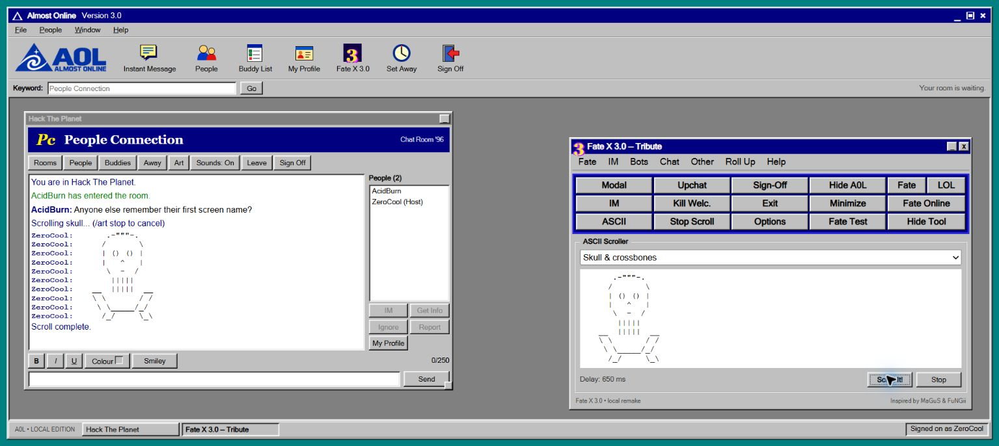

# Almost Online

**You've got nostalgia.**

A working love letter to 1996 chat rooms: chunky windows, screen names, buddy lists, instant messages and an ASCII proggie. Built with plain JavaScript, Node.js and WebSockets. No frontend framework or build step.



[](https://github.com/pnmcguire480/almost-online/actions/workflows/ci.yml)
[](LICENSE)

## Bring the room back

This is the starting point for a collaboration. Remember your first screen name? Built a VB proggie? Have old screenshots, an ear for dial-up sounds, or an itch to make small online communities feel human again?

**[Come say hello in Discussions](https://github.com/pnmcguire480/almost-online/discussions)**. Share a memory, break the local build, pick an issue or propose what a connected version should become. [Roadmap](ROADMAP.md) · [Contributing](CONTRIBUTING.md) · [Open issues](https://github.com/pnmcguire480/almost-online/issues)

## Run it

Install a current **Node.js 24 or newer**, then:

```sh
git clone https://github.com/pnmcguire480/almost-online.git
cd almost-online
npm ci
npm start
```

Open [127.0.0.1:1996](http://127.0.0.1:1996). Open a second tab, choose another screen name, and chat. Screen names use 3–10 letters or numbers.

The server binds to `127.0.0.1`. This release runs on your computer; it does not provide a public chat service. Everyone using the same running server shares its rooms. There are no passwords or saved chats. Session data disappears on sign-off or restart; only the sound preference stays in browser storage. [Security model](SECURITY.md).

## Inside the room

- Public lobbies with overflow, member rooms and host controls.
- Instant messages, away replies, buddy presence and session profiles.
- Ignore, reports, text formatting, smileys and synthesized sound effects.
- Almost Online / A0L 3.0 parody shell, toolbar and Keyword navigation.
- Fate X 3.0 tribute control panel with preview, print and stop controls.

Type these in the room's Message box:

| Command | Result |
| --- | --- |
| `/art` | Open the picker and preview |
| `/art skull` | Skull and crossbones |
| `/art finger` | The classic middle finger (`middlefinger` also works) |
| `/art banner` | CHAT ROOM '96 banner |
| `/art divider` | Old-school divider |
| `/art stop` | Stop your current scroll |

The Fate X toolbar button opens the same picker. **Scroll It!** prints one line every **650 ms**, preserving spaces in a fixed-width font. Ignore applies to each line. Leaving, being kicked, signing off or disconnecting cancels your unfinished scroll.

## Foundation

Browser-origin and Host checks protect the local WebSocket endpoint. File serving checks canonical paths, including symlink/junction targets. Connections, frames, message rate, output buffers, ignore lists and retained reports have limits. Chat text is rendered as text, with a Content Security Policy as another boundary.

```sh
npm test
npm run test:coverage
npm run test:controls
```

CI runs on Windows and Linux. Coverage enforces a **90% server line floor**; browser JavaScript is outside that metric. Deliberately broken controls prove tests detect missing protections. [Release verification](docs/releases/v0.1.0.md) · [Wire protocol](docs/PROTOCOL.md) · [Earlier verification](docs/VERIFICATION.md)

## Credits and license

MIT licensed. An independent, unofficial tribute to the AOL era and to **Fate X 3.0 by MaGuS & FuNGii**. Almost Online is newly written software; the original authors are credited for inspiration and did not write or endorse this remake. It does not connect to AOL. [Credits and asset provenance](CREDITS.md) · [Historical notes](docs/HISTORY.md)
