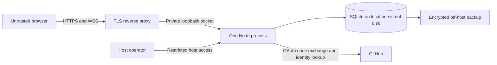

# Connected edition: open registration

Status: proposed for review under [issue #3](https://github.com/pnmcguire480/almost-online/issues/3), 2026-10-22. This is a design, not an implemented hosting feature or a completed security assessment. v0.1.1 remains local-only.

The project owner chose **open registration**. People should be able to make an account and join without an invitation or individual approval. Private rooms come later, when the community needs them. The defaults below are proposals to test before launch.

## First hosted milestone

Keep the Almost Online shell, public rooms, buddies, IMs and Fate X scroller. Add persistent accounts, protected screen names, logout/revocation, blocking, moderator tools and an operator runbook. Start with 25 people online at once and 23 per room. Registration remains self-service when capacity permits; a full room or server offers a retry, not an invite requirement.

Propose GitHub sign-in for this first collaboration-focused release. Anyone with a GitHub account can register; repository membership, a star or a follow grants no privilege. This adds friction for people who do not use GitHub. Confirm that trade-off in review before implementation; keep provider identity separate from the chat account so another login method can be added later. No app passwords, automatic account linking by email, file uploads, bots or external-network bridges in this milestone.

Hosting provider, domain, spending limit and named operator coverage remain unset. A successful local test does not resolve those launch requirements.

Threat actors include malicious registrants, members using custom clients, a malicious website opened by a signed-in member, stolen sessions and callers forging proxy headers. Protect account ownership, private IM delivery, moderation authority, retained evidence and availability. A compromised host or identity provider remains a privileged compromise; application permissions do not contain it.

The current implementation needs these specific changes:

| Current behavior | Connected requirement |
| --- | --- |
| [`ChatHub.signOn`](../lib/hub.js) accepts a free screen name | Provider-backed account and transactional name reservation |
| [`Client` / `onMessage`](../lib/hub.js) keep per-connection state and limits | Revocable account sessions and quotas that survive reconnects |
| [`im` / `buddyAdd` / `ignore`](../lib/hub.js) use session name lists | Recipient-owned consent and persistent account-level blocks |
| [`report`](../lib/hub.js) stores name/time only in memory | Restricted, durable reports and accountable moderation |
| [`localHost` / `sameOrigin`](../lib/security.js) accept loopback hosts and missing Origin | A separate connected policy with exact HTTPS origin, session and proxy checks |

## Architecture and trust boundaries

| Boundary | Required contract |
| --- | --- |
| Browser to edge | One configured HTTPS origin; no cross-origin application API; HTTP redirects to HTTPS. WSS only. |
| Edge to Node | Node still binds loopback. Only the configured proxy can reach it; the proxy replaces forwarded headers. Never trust a caller-supplied IP, Host or scheme. |
| Request to account | A valid server session supplies the account ID. Names, account IDs, role fields and room IDs in client input convey no authority. |
| Account to room or recipient | Server checks current membership, sanctions, block rules and recipient consent before each action and delivery. |
| App to identity provider | Fixed authorization/token/API endpoints and callback URL. Upstream identity comes from an authenticated provider response, never from browser JSON. |
| App to database | Parameterized queries, unique constraints, transactions and tested migrations. An unavailable or incompatible store denies protected operations. |
| Operator to service | Host access and backups are privileged. App moderators do not gain host access or a general IM-reading API. |

One process keeps socket revocation and moderation ordering tractable; SQLite avoids a second service for the initial small deployment. Its write concurrency is a constraint, so load-test the chosen host and revisit before multiple writers or replicas. [SQLite deployment guidance](https://www.sqlite.org/whentouse.html).

Local mode stays the default. Connected mode must be explicit and refuse startup without a valid HTTPS public origin, dedicated login configuration, persistent database, session secret and proxy configuration. It must never fall back to guest sign-on after an auth, configuration or storage error. The current local wire contract stays documented separately in [PROTOCOL.md](PROTOCOL.md); publish a versioned connected contract before changing frames.

## Accounts and screen names

Each account has an internal random ID and a unique `(provider, provider_user_id)` pair. For GitHub, use the numeric ID from authenticated `GET /user`, not the mutable login name. That endpoint can return the public identity with an unscoped token. [GitHub authenticated-user API](https://docs.github.com/en/rest/users/users#get-the-authenticated-user).

Claim a 3–10 character ASCII alphanumeric screen name once, using a unique lowercase database key. Concurrent claims have exactly one winner. Logging out, provider renaming, case changes and restarting do not free the name. Reserve staff/service names during bootstrap. No self-service rename or reassignment in the first milestone; account deletion retires the name until a reviewed deletion/reuse policy exists. Blocks and sanctions always target account IDs.

Bootstrap the first owner through restricted host access using a specific verified provider ID; never make the first registrant an owner. No browser field or special screen name grants a role. Protect the last owner from deletion or demotion. Adding an owner requires host access and an audit event.

Registration creates an account only after successful provider verification and explicit acceptance of the displayed community and privacy rules. A transaction checks enrollment status, provider uniqueness, screen-name uniqueness and total capacity. Repeated callbacks must not create duplicate accounts or bypass quotas. A provider account proves control of that account, not that a person is harmless or unique.

## Login and revocable sessions

Use a maintained OAuth client with authorization code flow, PKCE S256 and one-use browser-bound state. Store login attempts server-side for five minutes, bound to a separate Secure/HttpOnly/SameSite=Lax cookie. Fix the callback and post-login destination; do not accept arbitrary redirects. Consume state atomically, including on a failed exchange. Test missing, swapped, expired and replayed state. GitHub documents these flow parameters in its [authorization guide](https://docs.github.com/en/apps/oauth-apps/building-oauth-apps/authorizing-oauth-apps).

Use a dedicated login-only OAuth application with no requested scopes. Verify returned grants and reject unexpected permissions rather than reusing a broadly authorized integration. Fetch only the upstream ID needed for login, then discard the access token; do not store refresh tokens or ask for repository/email access. [GitHub scope reference](https://docs.github.com/en/apps/oauth-apps/building-oauth-apps/scopes-for-oauth-apps).

After login, issue a fresh opaque 32-byte random token. Store its keyed hash, account ID, creation/expiry times and revocation state server-side, using a standard HMAC primitive and a dedicated session secret. Cookie: `__Host-a0l_session; Secure; HttpOnly; SameSite=Strict; Path=/`, with no Domain. No session token in a URL, browser storage, trace or application log. HTTP mutations require same-origin validation and a session-bound CSRF header; ordinary GET endpoints are read-only, with the one-use OAuth callback completing login. [OWASP session guidance](https://cheatsheetseries.owasp.org/cheatsheets/Session_Management_Cheat_Sheet.html).

Proposed session lifetime: 12 hours absolute and 30 minutes without user activity; ping/pong and incoming chat do not extend it. Keep the existing chat idle warning separate from authentication expiry. Three login sessions per account at most, with an explicit device/session list and revoke-all action. At capacity, require an explicit choice to revoke an existing session rather than silently replacing it.

Account deletion, revoke-all and moderation actions require an explicit same-origin confirmation and a login flow completed within five minutes. Cancelled or failed login must leave the requested operation undone. An OAuth round trip can reuse an upstream browser session; it is not proof of password reentry or a fresh MFA challenge. Operators and moderators must protect provider/host credentials with MFA under the operating policy; do not claim the unscoped GitHub response enforces or verifies that policy. Review stronger step-up authentication before expanding privileged access.

Proposed HTTP surface: login start/callback, registration, own account/session list, logout/revoke, own buddy/block lists, report submission and role-restricted moderation. Keep authenticated responses `Cache-Control: no-store`, disable cross-origin API access, and cap every list/page/body. Registration uses a five-minute one-use provisional identity from the verified callback plus same-origin CSRF protection; it grants no chat access before name/rules acceptance commits. Fix endpoint names and errors in the connected wire contract during milestone 1.

Only one active chat connection per account initially. A second tab receives an already-connected response; it must not evict the first. Cleanup must match the exact connection instance so a delayed close cannot delete a newer connection. Signing off in connected mode logs out that browser session; other sessions survive unless explicitly revoked.

### WebSocket authorization and cancellation

Check exact configured Host and Origin, valid session, expiry, account status and connection quota **before** upgrade. Connected browser requests with absent or `null` Origin are denied. Origin checking alone does not authenticate a protocol client. Recheck the session, account and action permission for every frame; recheck both participants and room membership before asynchronous delivery. These boundaries follow [OWASP's WebSocket guidance](https://cheatsheetseries.owasp.org/cheatsheets/WebSocket_Security_Cheat_Sheet.html).

Logout, expiry, ban and revoke-all must invalidate the authority, cancel its art/jobs, remove presence and close affected sockets. A revocation acknowledgement means no subsequent frame can initiate work and no remaining scheduled art line can be submitted to a socket. Already transmitted bytes cannot be recalled. Schedule expiry even on idle sockets; fail closed on authorization-store failure. Apply revocation through one serialized path, with no asynchronous gap between the final permission check and sending. Database failure during logout closes the connection and stops protected service until durable revocation succeeds; never acknowledge an uncommitted logout.

## Rooms, buddies and IMs

Initial connected rooms, including user-created member rooms, are **public to signed-in members**. Say so in the creation UI. Anonymous visitors see a landing page and sign-in, not room rosters, messages, profiles or presence. There is no chat history replay. Leaving or being kicked removes membership before another message or art line can be delivered. A room host can remove an occupant from that room; this does not grant a global moderation role.

Buddies become persistent account references. Adding someone is unilateral and does not authorize messaging them. By default an IM is delivered only if the recipient has explicitly enabled IMs from that sender through their own buddy list. The UI must disclose that permission when adding a buddy. Both directions require their own consent; no unsolicited message-request inbox in the first release. Removing permission immediately stops new IMs and away replies. Authorization applies to alternate protocol clients as well as the UI.

Persist blocking separately from the local session ignore feature. A block in either direction prevents IMs, away replies and buddy-presence notifications between those accounts; profile/presence lookups return the same unavailable result used for inaccessible accounts. Remove blocked participants' content from the blocker's visible room transcript and filter subsequent room/art lines there. Public room messages remain readable by other signed-in occupants, including a blocked account; shared rosters can reveal co-presence. A block is not invisibility or a room ban, and cannot retract a message already received. Blocked senders get a generic unavailable result, not an explanation of the recipient's settings. Restarting, reconnecting or changing provider login does not remove a block.

### Later: private rooms

Once there is demand, add explicit room membership and invitations with expiry/revocation. A private room must deny discovery, roster/profile context, join, messages, art and history to nonmembers on every access path. A secret room name or hidden UI is insufficient. Removing membership cancels pending work and stops delivery immediately. Specify owner succession and recovery before shipping private rooms. This is a later milestone; it must not quietly change public rooms into a privacy promise.

## Abuse controls and moderation

These are initial configurable ceilings, not demonstrated capacity or bot prevention. Enforcement returns a bounded error with retry guidance; it must not allocate unbounded limiter entries or amplify rejected traffic. Apply global admission limits before expensive provider/database work. Persist account budgets or conservatively restore them exhausted after restart; reconnecting must not reset them. IP limits supplement account limits and must allow for shared networks. Provider IDs and IP addresses are not unique-human identifiers.

| Resource | Proposed initial ceiling |
| --- | --- |
| Enrollment | 1,000 total accounts; 100 new accounts/day globally; 3/hour per trusted source IP; operator can pause enrollment without disabling existing accounts |
| Login | 10 new flows/minute/IP, 100/minute globally; 5 pending flows/browser, 1,000 pending globally; expired attempts removed |
| Connections | 25 online accounts, 1 chat/account, 5 upgrades/minute/account, 20/minute/IP; keep 128 absolute WS / 160 HTTP socket ceilings |
| Frames and text | Existing 4 KiB frame and 250-character text limits; account bucket burst 20/refill 5 per second across reconnects; same aggregate IP bucket at 5x allowance |
| Room output | 5 text/art lines per second, burst 20 per room; 2,000 recipient deliveries/second globally, burst 4,000, including art; reject or cancel excess work, never queue it indefinitely |
| Scroller | Existing server catalog and 650 ms pacing; one job/account, one job/room, 3 starts/minute/account; each line consumes output budgets |
| Rooms/lists | 10 rooms total, 1 owned room/account, 23 occupants/room; 50 buddies and 100 blocks/account; nonempty rooms are not evicted to make space |
| New accounts | First 10 minutes: normal conversation and blocking/reporting allowed; no room creation or art scrolling |
| Reports | 5/hour/account, 100/day globally; bounded evidence as below; clear failure/retry rather than a false acknowledgement when full |
| Memory/disk | Existing 64 KiB socket output ceiling; bounded login/limiter/report caches; storage-watermark admission stop and operator alert |

Owner appoints moderators; members cannot assign roles. Moderators can remove users from rooms, apply timed global chat mutes, suspend accounts and review reports. Only owners appoint/remove moderators. Mutes cover room text, art, IMs and away auto-replies, while allowing blocking, reporting and logout. Suspensions revoke all sessions and deny new login; reversing a suspension does not revive old sessions. Role changes affect existing connections and pending actions immediately.

Record actor, target, action, reason, time and outcome for role changes and sanctions; commit the decision and audit record atomically. Do not let room hosts erase global sanctions or moderators silently clear their own restrictions. Show users the conduct rules, report/block controls and an appeal route before launch. Designate an owner and backup operator, publish staffed hours, and pause new enrollment when moderation cannot keep up. Open registration is not a promise of unattended operation.

For floods, first pause new enrollment, lower admission or disable art; preserve existing blocks and moderation access. A separate emergency stop disconnects all chat sockets and rejects new chat work while preserving restricted host recovery. Volumetric traffic beyond the edge requires the hosting provider's controls; application quotas cannot guarantee availability under DDoS. Revisit challenges or stronger enrollment friction if measured abuse defeats the pilot limits.

## Data and privacy

Before signup, explain what other members and operators can see, who hosts the service, the provider login dependency, retention and how to request deletion. Chat is not end-to-end encrypted; the service processes plaintext. Keep provider identity private from other members. No production chat captured in CI videos, traces or analytics.

| Data | Proposed lifetime and access |
| --- | --- |
| Account/provider mapping, reserved name | While active; deletion disables login immediately, revokes sessions and removes profile/buddies/blocks within 7 days. Retain only a retired name and minimal restricted sanction record where needed to prevent reuse/evasion; disclose a reviewed lifetime before launch. |
| Profile, buddies, blocks | Until changed or account deletion; owner account may access its own lists, never another member's lists. |
| Sessions/login attempts | Sessions at most 12 hours; remove expired/revoked rows within 24 hours. Login attempts expire after 5 minutes. |
| Room/IM text | No durable transcript or replay. For reporting only, hold up to 2,000 recent messages / 2 MiB / 10 minutes in memory, evicting at the first bound; track which accounts actually received each item. Restart erases this cache. |
| Submitted reports | Up to 5 explicitly selected cached messages the reporter actually received, plus a 1,000-character narrative; 30 days after submission, hard cap 1,000 reports. Server-derived evidence is immutable; unverified narratives are labelled as such. Moderator access is audited. |
| Sanctions and audit events | Active sanctions for their stated duration; closed sanctions and audit records for 90 days. Owner must review any extension policy before launch. Hard caps and storage alerts prevent indefinite growth. |
| Request/security logs | At most 7 days; scrub cookies, OAuth callback query strings, message bodies and tokens at proxy and app. Do not place names/IMs in error stacks or monitoring payloads. |
| Recovery journal | Minimal account/name reservations and administrative decisions, encrypted off-host for 8 rolling days; operators only. Covers the oldest retained snapshot plus a restore window; halt restore if continuity is missing. |
| Backups | Encrypted daily snapshot, 7 rolling days, access limited to operators; disclose deletion lag. Restore stays offline until expiry/deletion and sanction reconciliation complete. |

The short report cache is a deliberate change from local v0.1.1's retention model. Ask for explicit evidence selection in the report UI, verify delivery eligibility on the server, and acknowledge only after durable submission. If evidence has expired, allow a labelled narrative report without inventing a verified transcript. Test both paths. Reports are restricted moderation data, not public GitHub issues.

Deletion must not be described as complete erasure while identifiers remain for sanctions or retired names. Resolve the exact sanction/tombstone retention policy in review and publish it before collecting real account data. Host access can inspect in-memory data; moderator authorization does not restrict a host operator.

## Operations and recovery

Run a patched, unprivileged Node service on a dedicated host, behind one TLS proxy, with a persistent local database volume outside `public/`. Keep production secrets, database files and backups out of the repository and static tree. No shared development PC or temporary tunnel. Enable HTTPS/WSS headers and change CSP connections to the exact secure endpoint; do not weaken the current script/text-rendering protections. Configure edge handshake limits, maximum request sizes (16 KiB for reports; smaller auth/account payloads), slow-client timeouts and redacted logs.

Use transactional versioned migrations with backups and a tested forward/recovery path. Never start a version against an incompatible schema or silently create an empty store after a missing-volume error. Create consistent live snapshots using SQLite's [backup facilities](https://www.sqlite.org/backup.html), not an unchecked copy of a live database file. Restore-test with synthetic accounts before launch and after storage/migration changes. Proposed recovery target: at most 24 hours of data loss and restoration within 4 hours, subject to a measured drill.

A restore may resurrect revoked sessions, roles, names and sanctions, or lose newly reserved names. Rotate the session secret and delete restored sessions before reopening, reconcile all post-snapshot account/name reservations, suspensions, role changes and deletion requests against the encrypted off-host recovery journal, then run expiry/deletion jobs. Acknowledged reservations and safety/deletion/role mutations must reach that journal before success; if it is unavailable, deny those mutations or stop protected service. If reconciliation cannot be verified, remain closed. Test the journal/DB crash windows and idempotent replay; fail closed on an ambiguous outcome. Backup encryption keys and host recovery credentials must be recoverable outside the failed host.

For a suspected compromise: stop chat/admission, revoke sessions, rotate affected secrets, preserve the minimum redacted incident evidence, patch and test in staging, restore/reconcile if necessary, and communicate status through a designated project channel. Publish neither raw reports nor tokens. Owner and backup operator need the documented commands for these actions, a working private vulnerability channel and an escalation contact. A provider outage prevents new login; valid existing sessions last only until normal expiry unless the incident requires revoke-all.

## Red-team acceptance plan

Every row below is a **future release gate**, not a claim about today's passing tests. Use deterministic clocks, isolated databases and a local fake provider for CI, plus one real-provider staging smoke test. Keep synthetic data in failure videos. Run server and browser suites on Windows/Linux, preserve the 90% server line floor, and test persistence and HTTP/WS boundaries through real workflows.

| ID | Workflow and required observation | Deliberately broken control |
| --- | --- | --- |
| C01 | New visitor self-registers without invite, claims a name, signs off, signs in again and retains ownership; two concurrent claims have exactly one winner. Provider rename and restart preserve the account. | Remove name/provider uniqueness; the race test fails. |
| C02 | Wrong-browser, expired, swapped, replayed or cancelled OAuth flows create no account/session; arbitrary redirects and unexpected grants fail. | Skip state/browser binding; swapped-browser test fails. |
| C03 | Anonymous HTTP and WS cannot read room/profile/presence data; forged account/role/name fields grant nothing; missing/null/foreign Origin and spoofed proxy headers are rejected. A real TLS staging connection succeeds. | Bypass session or Origin guard independently; each corresponding test fails. |
| C04 | Logout, idle/absolute expiry, revoke-all and ban stop existing sockets and in-flight art before acknowledgement; an already-connected tab cannot be replaced by a stale close. Storage failure never yields an acknowledged but still-authorized logout. | Skip per-frame validation and job cancellation separately; both tests fail. |
| C05 | A nonmember cannot send, receive or stop another room's art; kick/leave takes effect before the next line. Private-room gates will be added before that later feature. | Remove membership/delivery check; an outsider observes the canary and the test fails. |
| C06 | Sender adding recipient to their buddies gives no IM permission. Recipient consent permits the intended direction; withdrawal/block stops IM and away reply without presence leaks. Block survives restart. | Consult the sender's list or drop the persisted block; tests fail. |
| C07 | Ordinary members/room hosts cannot suspend globally, assign roles, view reports or retrieve another member's lists. Demotion cancels queued moderator work; unban allows fresh login but never restores an old session. Last-owner removal fails. | Skip role recheck; a previously authorized moderator action wrongly succeeds. |
| C08 | Flood frames, reconnect, create many accounts/rooms, exceed login/report limits and simulate a slow peer. Existing synthetic peers remain responsive; memory/disk/cache ceilings hold and errors are bounded. Restart does not replenish abuse budgets. | Reset the account bucket on reconnect or omit global fan-out accounting; flood tests fail. |
| C09 | Literal HTML/script/SQL/control payloads remain text; oversized/fragmented/binary frames, unknown actions and malformed HTTP fail without process crash or data exposure. Existing scroller rendering/Stop tests still pass. | Existing unsafe-rendering control remains detected. |
| C10 | Report only messages actually delivered to the reporter; forged IDs, other people's IMs and client-edited evidence are refused. Expired evidence becomes an explicitly unverified narrative. Logs contain no canary tokens/text. | Skip receipt ownership; an unrelated account can attach a private canary and the test fails. |
| C11 | Delete account, restart, migrate and restore an older snapshot. Names do not become claimable, deleted data is reconciled, bans/role reversals survive, and all old sessions fail. Simulated crash between journal/DB steps is reconciled or keeps service closed. | Omit revocation/deletion replay; restored canaries reappear or regain access and the test fails. |
| C12 | Missing volume, incompatible migration, unavailable auth store, full disk or interrupted startup denies protected service. Emergency stop cancels work; only the intended enrollment switch leaves existing chat usable. | Fall back to an empty or guest store; anonymous signup/chat test fails. |
| C13 | Two independent browsers complete signup, chat, reciprocal IM consent, block/report and sign-off in HTTPS staging; operator suspends one, reverses it and restores backup within the measured target. 25 synthetic participants meet a documented latency/memory budget on the actual host. | Bypass one acceptance boundary at a time; required tests must fail before release. |

Negative assertions must use a completion/revocation barrier or controlled clock, not a short sleep and a lucky absence. Isolated mutations must fail for the intended assertion, not a syntax error or unrelated timeout. Publish the measured host/load envelope and restore evidence with the connected release; do not reuse local release evidence as proof of hosted safety.

## Implementation sequence and review

1. **Identity and storage:** approve provider/retention decisions; version the connected protocol; add migrations, login, screen-name ownership and revocable sessions behind explicit connected configuration. Test locally with a fake provider. Keep the default local release working.
2. **Access and moderation:** authenticated upgrades, action/delivery rechecks, cancellation, persistent buddy consent/blocks, roles, reports, account/global quotas, journal and emergency controls. Complete C01–C12 and their broken controls.
3. **Hosted pilot:** select host/domain/budget and named operators; write deployment/privacy/conduct/recovery pages; run real-provider HTTPS smoke, C13 and recovery drill. Then allow open self-service registration within measured capacity.
4. **Private rooms later:** design and test server-enforced membership, invitation/revocation, discovery and delivery isolation before offering that privacy promise.

Review must resolve the proposed GitHub-only entry path, initial limits, report-cache disclosure, deletion/tombstone retention and operator recovery journal. A maintainer or contributor should review the boundaries and acceptance plan before issue #3 closes. Track implementation separately; this document does not authorize announcing a live service before those gates pass.
