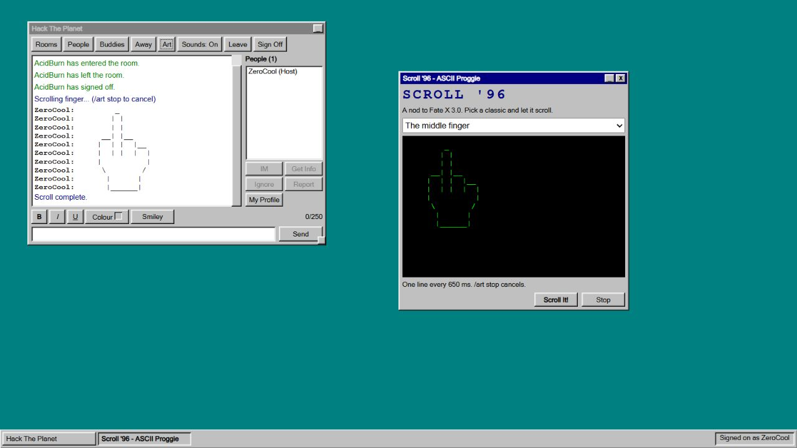

# Verification — 2026-10-15

Node 24.14.0 on Windows. Local server at http://127.0.0.1:1996.

`npm run test:coverage`: **87 passed, 0 failed**. Server line coverage **95.50%** across `server.js` and every `lib/*.js` file, including startup, configuration and static serving. `lib/art.js`: **100% lines, branches and functions**. The coverage command enforces a 90% server line floor. This metric does not include browser JavaScript; client workflows were exercised in the browser separately.

The original 65 tests passed before this work. The first native coverage report undercounted child servers because Windows test cleanup killed them without running shutdown. Tests now request a graceful shutdown over child-process IPC, exercising the real shutdown path and flushing child coverage. The 95.50% figure is from the corrected collection, not a retroactive reinterpretation of that first report.

`npm run test:controls`: four isolated deliberately broken implementations were rejected by their targeted tests. They removed room-departure cancellation, bypassed ignore filtering, trimmed ASCII whitespace, and changed pacing to zero milliseconds. The live source was never mutated.

## Browser workflows

Two independent tabs signed on as **ZeroCool** and **AcidBurn**:

- Signed on, created **Hack The Planet**, joined from the second tab, and saw matching occupancy and host status.
- Sent an IM, saw the receiving window appear, and verified smiley rendering in ordinary text.
- Set an away message and received the automatic reply through the other tab's IM window.
- Added a buddy and observed Online → Offline when the second user signed off.
- Printed skull and middle-finger art between tabs; printed the banner and divider through slash commands.
- Used `/art` and the Art toolbar to load the picker, preview and Scroll It! control.
- Used `/art stop`; the partial skull stopped after its first line.
- Inspected rendered art: leading spaces intact, `white-space: pre`, Courier New, and literal `:P` in the banner.

Automated tests additionally cover ignore during a scroll, room isolation, overlapping requests, independent senders, and cancellation on stop, room switch, leave, kick, sign-off, idle expiry, disconnect and shutdown. A live WebSocket test measures the actual interval between lines.

## Scope

Ready for the requested local nostalgic chat and ASCII-scroller workflow. This verifies the implemented contract, not exact historical AOL or Fate X binary parity. No original executable or art pack was installed. See `PARITY.md` for the broader scope and research confidence labels.

