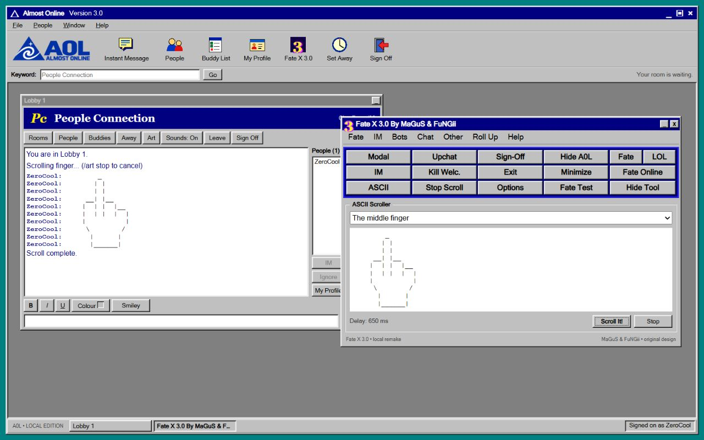

# Visual references and assets

Almost Online / A0L 3.0 uses a period-style application frame, icon toolbar, Keyword bar, grey workspace, People Connection header and branded sign-on window. The Fate X tribute uses a navy caption, multicolour 3 icon, menu strip, blue inset border and three-row control deck, guided by the [preserved Fate X 3.0 screenshot](https://plozee.com/wp-content/uploads/2024/12/Fate-X-3.0.webp). [Archive identification](https://justinakapaste.com/fate-x-3-0/).

The separate scroller panel provides a preview, four pieces, print and stop. Controls operate this project's local chat and UI. This is a newly implemented tribute, not a port of the original executable.

The Almost Online logo was generated for this project with OpenAI image generation: transparent PNG, blue triangular spiral emblem, A0L wordmark and ALMOST ONLINE subtitle. Icons and favicon are editable SVGs. Sound effects are synthesized. See [CREDITS.md](../CREDITS.md) for provenance.

Earlier visual verification on 2026-10-16: 87 tests passed and server line coverage was 95.50%. Browser checks covered sign-on, IM receipt in a second tab, skull and finger scrolling, Keyword navigation, Fate Test, Roll Up and taskbar restore. A narrow-layout Roll Up height bug was found and fixed (532 to 155 px on the repeated check). Those results describe that build; current release evidence is in [releases/v0.1.0.md](releases/v0.1.0.md).

